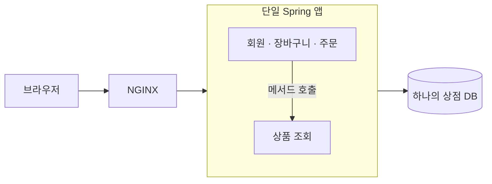
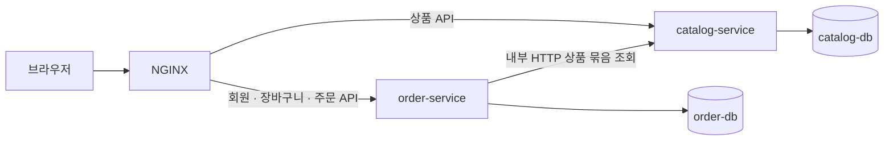

# 38강에서 정한 서비스 분리 계획

이 문서는 38강의 출발점과 최종 분리 계획을 설명합니다. 현재 39강의 실제 실행 구성은 [독립 상품 앱 설명](independent-catalog.md)에 있습니다.

상품 서비스는 현재 판매하는 상품의 코드·이름·분류·단가를 관리합니다. 주문 서비스는 회원·장바구니·주문을 관리하고, 주문 당시의 상품명과 단가를 주문 항목에 저장합니다. 따라서 상품명이 바뀌어도 과거 주문을 읽을 때는 저장된 이름이 나옵니다.

## 지금의 호출 관계

현재는 하나의 Spring 앱과 하나의 DB를 사용합니다. `CartService`는 `ProductService`를 호출하고, `OrderService`는 `ProductLookup`을 통해 상품 값을 받습니다. `DatabaseProductLookup`이 같은 DB의 상품 테이블을 읽어 `ProductSnapshot`으로 변환합니다.

패키지를 구분하면 코드의 책임을 읽기 쉬워집니다. 현재 실행·배포 단위는 여전히 하나이므로 상품 조회 코드를 바꿔 배포할 때도 상점 앱 전체를 교체합니다.

## 분리한 뒤의 데이터 책임

| 책임 | 최종 서비스 | 소유 데이터 |
|---|---|---|
| 현재 상품 목록·검색·단가 조회 | catalog-service | products |
| 가입·비밀번호 검증·세션 | order-service | members, 앱 메모리의 세션 |
| 내 장바구니 변경 | order-service | carts, cart_items |
| 주문 금액 계산·확정·취소·내역 | order-service | orders, order_items |

두 서비스는 자기 DB에만 접속합니다. 주문은 상품 코드와 주문 당시 값을 보관하며, 두 DB를 가로지르는 외래 키나 SQL 조인은 사용하지 않습니다. 서비스 사이에 필요한 값은 [상품 조회 계약](catalog-lookup-contract.md)으로 전달합니다. 이 계약에는 JPA 엔티티나 DB 접속 정보가 들어가지 않습니다.

## 분리할 때 얻는 것과 추가되는 일

상품 조회 기능을 바꿀 때 상품 앱만 빌드하고 배포할 수 있습니다. 상품 앱을 재시작하는 동안에도 주문 앱 프로세스는 유지됩니다. 다만 새 장바구니 금액이나 새 주문을 계산하는 요청은 현재 상품 정보를 받아야 하므로 상품 서비스의 응답에 의존합니다.

| 요청 | 상품 서비스 응답이 필요한가요? | 상품 서비스 중단 시 최종 동작 |
|---|---|---|
| 상품 목록·검색 | 예 | 상품 API 요청 실패 |
| 장바구니의 현재 가격·새 주문 금액 계산 | 예 | 제한된 시간만 기다리고 오류 안내 |
| 저장된 주문 상세·내 주문 목록 | 아니요 | 주문 DB의 저장값으로 응답 |
| 이미 확정된 주문 취소 | 아니요 | 주문 DB에서 상태 변경 |

분리 후에는 두 앱의 빌드·실행 설정, 두 DB의 마이그레이션과 백업, 통신 시간 제한, 응답 형식 검사, 요청 추적이 필요합니다. 상품 기능의 독립 변경·운영 수요가 이러한 작업 비용보다 큰지 판단해야 합니다. 이 과정은 같은 기능을 단일 앱과 분리된 앱에서 비교하기 위해 두 구조를 모두 구현합니다. 실제 소규모 상점은 단일 앱으로도 시작할 수 있습니다.

서비스 경계는 업무 책임과 변경 관계를 바탕으로 정하고, 각 서비스가 소유한 데이터는 그 서비스의 인터페이스를 통해 사용합니다. [업무 기준으로 경계 정하기](https://learn.microsoft.com/en-us/azure/architecture/microservices/model/domain-analysis), [서비스별 데이터 관리](https://learn.microsoft.com/en-us/azure/architecture/microservices/design/data-considerations)

## 원격 조회와 주문 저장의 순서

주문 앱은 장바구니의 코드·수량·revision을 읽고 읽기 트랜잭션을 끝냅니다. 그다음 상품을 HTTP로 조회합니다. 응답을 검사하고 금액을 계산한 뒤, 짧은 쓰기 트랜잭션에서 장바구니 revision을 다시 확인하고 주문 저장과 장바구니 비우기를 함께 처리합니다.

상품 응답을 기다리는 동안 주문 DB의 쓰기 잠금을 잡지 않도록 이 순서를 선택합니다. 조회 후 장바구니가 바뀌었으면 409로 거부하고 새 장바구니를 보여 줍니다. 외부 상품 조회와 로컬 DB 저장 전체를 하나의 원자적 트랜잭션으로 묶지는 않습니다. 현재 가격을 조회해 주문에 기록하는 이 과정에는 재고 차감이나 결제처럼 다른 서비스의 데이터를 변경하는 작업이 없습니다.

## 구현 순서

| 강의 | 실행 구조의 변화 |
|---|---|
| 38강 | 단일 앱을 실행하며 경계·계약·실패 조건 정리 |
| 39강 | 독립 상품 앱·DB 추가. 기존 상점은 전환 전 로컬 상품 조회 유지 |
| 40강 | 주문 앱의 상품 조회를 HTTP로 바꾸고 주문 DB의 상품 테이블 제거 |
| 41강 | 브라우저 상품 API를 NGINX에서 상품 앱으로 전달 |
| 42강 | 상품 통신의 시간 제한·실패 응답·읽기 재시도 검증 |
| 43강 | 중복 주문 방지와 장바구니 변경 충돌 처리 |
| 44~45강 | 두 앱의 요청 추적과 전체 시나리오 검증 |

39강의 두 상품 데이터는 전환 과정을 보여 주는 초기 예제입니다. 현재 예제에는 상품 수정 API가 없으며, 40강 전환 이후에는 catalog-db가 현재 상품 정보의 유일한 원본이 됩니다. 운영 데이터의 실시간 이전이나 양방향 동기화는 이 실습 범위에 포함하지 않습니다.
