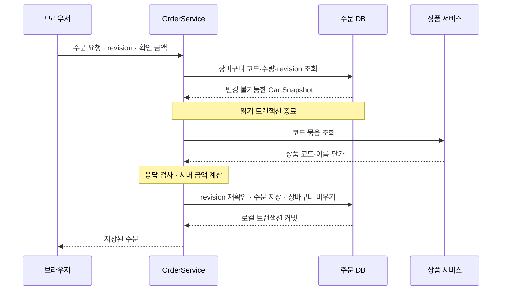

# 상품 값을 받은 뒤 주문 DB에 저장하기

키보드 2개와 마우스 1개의 주문을 계산하려면 현재 단가 두 개가 필요합니다. 주문 앱은 P001·P002를 한 번의 HTTP 요청으로 보내고, 상품 앱이 반환한 30,000원·15,000원으로 총액 70,000원을 계산합니다. 주문 DB의 상품 테이블을 읽는 코드는 제거했습니다.

## 호출 흐름

`CartSnapshot`에는 JPA 엔티티 대신 코드·수량·revision 값이 들어갑니다. 읽기 트랜잭션이 끝난 뒤에도 필요한 값을 사용할 수 있습니다. 상품 응답은 `ProductSnapshot`으로 바꾸고, 주문은 이 값으로 계산합니다.

## ProductLookup의 구현을 바꾸기

기존 `DatabaseProductLookup`은 상품 저장소를 호출했습니다. 현재 `HttpProductLookup`은 `RestClient`로 `/internal/products/lookup`을 호출합니다. `ProductLookup.findByCodes`가 여러 상품을 한 번에 받으므로 상품별로 HTTP 요청을 반복하지 않습니다. [Spring RestClient](https://docs.spring.io/spring-framework/reference/integration/rest-clients.html)

HTTP 응답에는 존재하는 요청 상품만 들어올 수 있습니다. `requireAll`은 주문에 필요한 코드가 모두 있는지 검사합니다. P001만 있고 P002가 없으면 `PRODUCT_NOT_FOUND`와 404를 반환하고 주문 전체를 거부합니다. 해당 요청으로 주문을 저장하거나 장바구니를 비우지 않습니다.

## 응답에서 확인하는 값

| 확인 대상 | 거부하는 예 |
|---|---|
| JSON과 응답 구조 | 잘못된 JSON, 중복 필드, products 배열 누락 |
| 코드 대응 | 요청하지 않은 코드, 같은 코드가 두 번 나옴 |
| 이름·코드 | 공백 값, 길이 초과, 코드 앞뒤 공백 |
| 단가 | 문자열·소수·0원·1,000,000원 초과·long 범위 초과 |
| 전송 형식·크기 | JSON이 아닌 Content-Type, 1MiB 초과 응답 |

형식이 어긋난 응답은 503 `CATALOG_RESPONSE_INVALID`, 연결 실패나 상품 서버의 오류 응답은 503 `CATALOG_UNAVAILABLE`로 처리합니다. 정상 200 응답에서 상품이 빠진 경우의 404와 구분합니다. 외부 응답에서 받은 숫자도 서버의 금액 규칙에 맞는지 검사한 뒤 계산합니다.

현재 연결 대기는 최대 1초, 한 번의 요청 읽기 제한은 2초이며 자동 재시도는 하지 않습니다. Spring Framework 7.0.10의 JDK 요청 구현은 읽기 제한이 지나면 응답 본문 스트림도 닫습니다. 실제 시간 제한과 읽기 재시도 시나리오는 42강에서 이어서 다룹니다. [해당 버전의 요청 구현](https://github.com/spring-projects/spring-framework/blob/v7.0.10/spring-web/src/main/java/org/springframework/http/client/JdkClientHttpRequest.java)

## 원격 대기 중에 장바구니가 바뀐다면

상품 응답을 기다릴 때 주문 DB의 쓰기 잠금은 잡고 있지 않습니다. 다른 요청이 장바구니 수량을 바꾸면 revision도 바뀝니다. 응답을 받은 주문은 `OrderWriter`의 짧은 쓰기 트랜잭션에서 현재 revision을 다시 확인합니다. 처음 읽은 값과 다르면 409 `CART_CHANGED`로 거부합니다.

따라서 원격 호출 전에 한 번, 저장 직전에 한 번 장바구니 상태를 확인합니다. 요청 당시 확인 금액과 새로 계산한 금액이 다르면 `PRICE_CHANGED`로 새 확인을 요청합니다. 상품 응답을 받은 뒤 상품 가격이 바뀌는 경우에는 이번 요청이 받은 단가로 주문을 확정하고, 다음 조회부터 바뀐 단가를 사용합니다.

전체 흐름을 담당하는 메서드는 `Propagation.NEVER`로 기존 DB 트랜잭션 안에서 호출되지 않게 합니다. DB를 읽거나 쓰는 별도 빈의 메서드에만 `@Transactional`을 적용합니다. 이 구분은 HTTP 대기를 포함하는 큰 쓰기 트랜잭션이 다시 생기는 것을 막습니다. `HttpProductLookup`도 실제 트랜잭션이 활성 상태라면 호출을 거부합니다.

## 상품 서비스가 중단되어도 가능한 작업

새 장바구니 금액과 새 주문은 현재 상품 값이 필요하므로 503을 반환합니다. 저장된 주문의 목록·상세·취소는 주문 DB만 사용하므로 계속 처리할 수 있습니다. 주문 앱의 readiness와 시작 조건에는 자기 DB를 사용합니다. 상품 앱이 중단된 상태에서도 주문 앱을 재시작하고, 다시 로그인해 과거 주문을 조회할 수 있습니다.

## 이번 강의의 브라우저 상품 경로

브라우저는 계속 `/api/products`를 사용합니다. 현재 NGINX는 이 요청을 주문 앱으로 보내고, 주문 앱의 임시 상품 전달 코드가 상품 앱을 호출합니다. 장바구니·주문용 내부 묶음 조회와 브라우저용 상품 목록 조회의 경로를 구분해 주세요. 다음 강의에서 NGINX가 상품 앱으로 직접 전달하도록 바꾸면 이 임시 코드가 필요 없어집니다.
