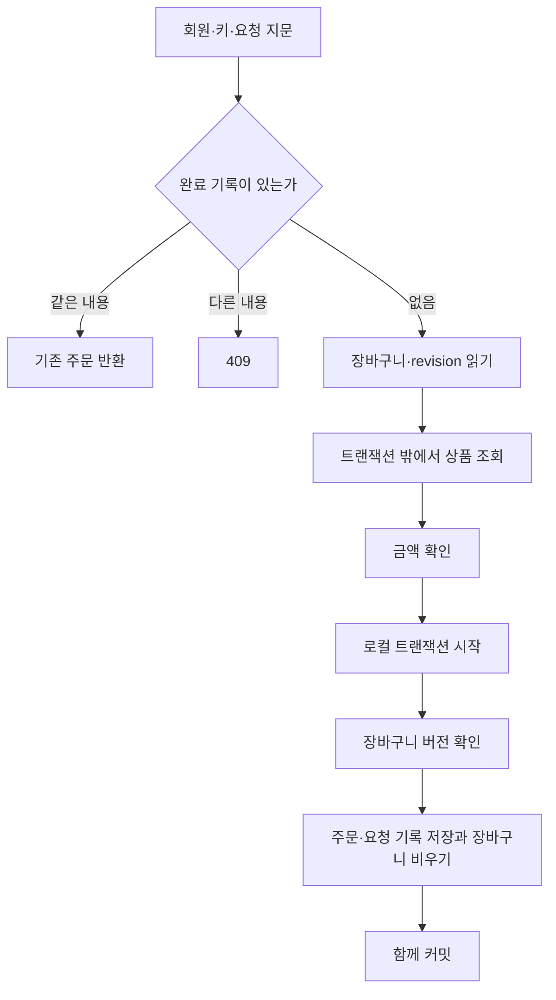

# 응답을 못 받은 주문을 다시 보내기

서버가 주문을 저장한 직후 연결이 끊기면, 화면은 주문 성공 여부를 알 수 없습니다. 사용자가 같은 주문 요청을 다시 보냈을 때 서버가 기존 주문을 찾아주려면 요청 자체를 식별할 값이 필요합니다. 이 프로젝트에서는 회원 번호와 `Idempotency-Key`를 함께 사용합니다.

## 같은 키와 같은 내용의 기준

키는 영문·숫자·밑줄·하이픈으로 구성한 16~80자 문자열입니다. 화면은 UUID를 만듭니다. 서버는 `cartRevision`과 `expectedTotalWon`을 정해진 순서의 문자열로 만든 뒤 SHA-256 지문을 저장합니다. JSON의 공백이나 필드 순서는 지문에 영향을 주지 않습니다. 회원 번호는 요청 본문에서 받지 않고 로그인 세션에서 가져옵니다.

| 다시 들어온 요청 | 결과 |
|---|---|
| 같은 회원·키·내용 | 기존 주문 번호와 저장된 주문 반환 |
| 같은 회원·키, 다른 버전 또는 금액 | 409 `IDEMPOTENCY_KEY_REUSED` |
| 다른 회원, 같은 키 | 각 회원의 별도 요청으로 처리 |
| 키 누락·형식 오류 | 400 `INVALID_IDEMPOTENCY_KEY` |
| 다른 키로 이미 주문한 장바구니 버전 사용 | 409 `CART_CHANGED` |

최초 주문과 재전송 응답은 모두 201이며 `Location`은 같은 주문 주소입니다. 재전송 때 주문이 이미 취소된 상태라면 같은 주문 번호와 `CANCELLED`를 반환합니다. 현재 상태를 조회하는 계약이므로 최초 응답 본문 전체를 그대로 보관해 반환하는 방식과는 차이가 있습니다.

## 읽기와 저장의 순서

완료 기록을 장바구니와 상품보다 먼저 읽습니다. 첫 주문으로 장바구니가 비워졌거나 상품 서비스가 중단되어도, 같은 요청의 재전송은 주문 DB만으로 처리할 수 있습니다. 기록은 자동 만료하지 않습니다. V9는 기존 장바구니에 `version`을 추가하고 `order_requests`를 생성합니다. 이전 강의에서 만든 주문에는 요청 키가 없으므로 새 주문부터 재전송 키가 기록됩니다.

## 두 요청이 동시에 기록을 못 찾은 경우

처음 조회할 때 둘 다 기록이 없을 수 있습니다. 이 때문에 사전 조회만으로 중복을 막을 수는 없습니다. DB의 `(member_id, request_key)` 유일 제약이 같은 회원·키의 완료 기록을 한 건으로 제한합니다. 주문·요청 기록·장바구니 비우기는 한 트랜잭션에서 처리하므로, 충돌한 요청이 만든 주문과 항목도 함께 롤백됩니다. [PostgreSQL 유일 제약](https://www.postgresql.org/docs/18/ddl-constraints.html#DDL-CONSTRAINTS-UNIQUE-CONSTRAINTS)

실패한 저장 트랜잭션이 끝난 다음 `OrderRequestReader`가 새 읽기 트랜잭션으로 완료 기록을 다시 조회합니다. 같은 내용의 기록이 있으면 승리한 요청의 주문을 반환합니다. 다른 키로 같은 장바구니를 주문하다 충돌한 경우에는 409를 반환합니다. 첫 키 조회 직후 다른 요청이 커밋해 장바구니가 비워지는 경우에도 완료 기록을 재확인합니다. [트랜잭션 전파와 별도 트랜잭션](https://docs.spring.io/spring-framework/reference/data-access/transaction/declarative/tx-propagation.html)

## 화면의 revision과 JPA version

`revision`은 사용자가 확인한 장바구니 상태를 나타냅니다. 장바구니 응답에 들어 있으며 변경 요청은 `X-Cart-Revision`, 주문 요청은 본문의 `cartRevision`으로 전달합니다. 이전 화면의 값이면 상품 조회와 저장 전에 409로 끝납니다. DELETE도 헤더로 전달하므로 요청 본문이 필요하지 않습니다.

`version`은 JPA가 DB에 저장할 때 동시 변경을 검사하는 값입니다. 두 트랜잭션이 같은 버전을 읽고 수정하면 한쪽만 그 버전으로 저장할 수 있습니다. 이 강의에서는 장바구니 쓰기의 비관적 잠금을 제거하고 `@Version`으로 충돌을 감지합니다. 충돌한 트랜잭션의 자식 항목 변경도 함께 롤백됩니다. [Jakarta Persistence Version](https://jakarta.ee/specifications/persistence/3.2/apidocs/jakarta.persistence/jakarta/persistence/Version.html)

장바구니는 담기·수량 변경·삭제·비우기 때 부모의 `revision`을 직접 증가시킵니다. 부모 자체가 변경되므로 자식 항목만 수정한 작업에도 부모의 버전 검사가 실행됩니다. `revision`은 화면의 확인 시점을, `version`은 저장 순간의 경쟁을 검사하는 역할입니다.

## 화면에서 보관하는 정보

화면은 사용자가 금액을 확인한 뒤 주문 버튼을 누르면 키와 본문을 먼저 `sessionStorage`에 저장합니다. 서버 응답을 받기 전에 새로고침해도 같은 탭에서 같은 회원으로 로그인하면 이 정보를 복원합니다. 응답 유실·5xx·인증 오류에서는 기록을 유지하고, 성공 또는 재확인이 필요한 일반 4xx 응답에서는 기록을 지웁니다.

미확인 주문이 있으면 새 주문 확인을 잠시 막고 `이전 주문 결과 다시 확인` 버튼을 보여 줍니다. 버튼은 같은 키와 본문을 보내므로, 이미 저장된 주문은 기존 번호를 반환하고 아직 저장되지 않은 요청은 현재 조건을 검사한 뒤 처리합니다. 브라우저 저장 공간을 사용할 수 없어 키를 보관하지 못하면 주문 요청을 보내지 않습니다.

이 브라우저 기록은 탭의 수명에 묶여 있습니다. 탭을 닫아 기록이 사라져도 서버의 주문과 요청 기록은 DB에 남습니다. 같은 회원의 주문 내역에서 완료 여부를 확인할 수 있으며, 임의의 새 키는 이전 요청을 식별하지 못합니다.
