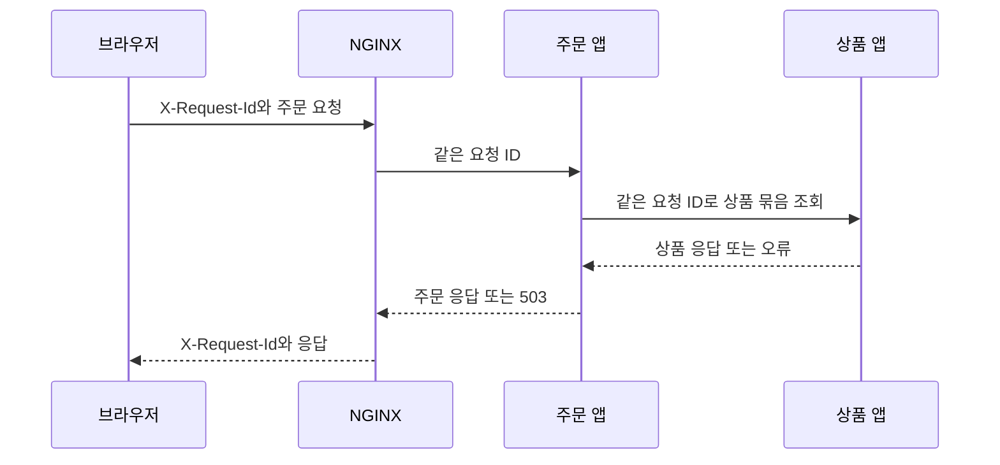

# 한 요청을 세 서비스의 로그에서 찾기

새 주문에서 503이 나오면 화면의 오류 안내에 요청 ID가 함께 표시됩니다. 이 ID로 NGINX, 주문 앱, 상품 앱의 로그를 찾으면 같은 요청이 어떤 경로를 거쳤고 어느 단계에서 실패했는지 알 수 있습니다.

## 요청 ID와 주문 키의 차이

| 값 | 식별하는 대상 | 다시 요청할 때 |
|---|---|---|
| `X-Request-Id` | HTTP 요청 한 번의 처리 경로 | 브라우저가 새 ID 생성 |
| `Idempotency-Key` | 이미 확인한 주문 의도 | 같은 키와 본문 유지 |
| `X-CSRF-TOKEN` | 변경 요청의 CSRF 검사용 토큰 | 현재 로그인 세션의 토큰 사용 |

주문 한 번을 처리하다 상품 조회를 재시도하면 같은 요청 ID로 두 번 호출합니다. 주문 앱의 재시도 로그에 `attempt`가 들어 있으므로 같은 요청 안의 첫 시도와 두 번째 시도를 구분할 수 있습니다. CSRF 토큰 조회는 주문 요청에 앞선 별도 HTTP 요청이므로 자체 요청 ID를 사용합니다.

## 어떤 ID를 받아들일지 정하기

NGINX와 두 앱은 영문·숫자·밑줄·하이픈으로 구성한 8~64자의 ID만 그대로 전달합니다. 없거나 형식이 다르면 새 ID를 만듭니다. 같은 헤더가 여러 번 들어온 경우도 새 값으로 바꿉니다. NGINX는 앱의 응답 헤더를 숨기고 최종 ID 헤더를 한 번만 붙이므로 중복 헤더가 생기지 않습니다.

ID는 로그를 연결하는 값입니다. 회원 확인과 접근 권한은 세션 인증으로 판단합니다. 사용자가 보낸 ID가 형식에 맞더라도 서로 다른 요청에 같은 값을 붙일 수 있으므로, 로그를 읽을 때는 시각·경로·상태도 함께 봅니다.

## 두 앱의 요청 기록

`RequestIdFilter`는 요청 ID를 요청 속성과 MDC에 넣습니다. MDC는 현재 처리 스레드의 로그에 공통 값을 붙이는 문맥 저장소입니다. 컨트롤러가 끝나면 메서드·경로 패턴·상태·소요 시간을 기록하고, 이전 MDC 값을 복원하거나 제거합니다. 같은 스레드가 다음 요청을 처리할 때 이전 요청 ID가 남지 않도록 하는 순서입니다.

Spring Boot의 ECS 형식을 사용해 로그 한 줄을 JSON 객체로 출력합니다. 서비스 이름과 요청 ID, 명시적으로 넣은 키·값이 함께 기록됩니다. [Spring Boot 구조화 로그](https://docs.spring.io/spring-boot/reference/features/logging.html#features.logging.structured)

| `event` | 발생 위치 | 읽을 필드 |
|---|---|---|
| `proxy_request` | NGINX 접근 로그 | `requestId`, `route`, `status`, `service`, `upstreamStatus` |
| `http_request` | 각 앱의 요청 종료 | `requestId`, `route`, `status`, `durationMs` |
| `catalog_http_error` | 주문 앱이 상품 앱의 오류 응답을 받음 | `requestId`, `remoteStatus` |
| `catalog_lookup_failure` | 재시도 가능한 상품 호출 실패 | `requestId`, `attempt`, `remainingMs` |
| `request_error` | 앱의 예상 밖 예외 | `requestId`, `exceptionType`, 제한된 스택 추적 |

`route`는 `/api/orders/{id}`처럼 변수 자리를 남긴 경로 패턴입니다. NGINX는 정의한 경로 표를 사용하고, 앱은 처리한 컨트롤러의 매핑을 사용합니다. 매핑 전에 차단되거나 일치한 경로가 없으면 `unmatched`가 나올 수 있습니다. 요청 본문·쿼리 문자열·쿠키·인증 헤더를 요청 요약 필드에 넣지 않습니다.

## 상품 DB 장애를 따라 읽기

정상 주문을 하나 만든 뒤 다음 순서로 실습합니다.

1. 새 주문에 쓸 장바구니를 채우고 금액을 확인합니다.
2. `docker compose stop catalog-db`로 상품 DB를 중단합니다.
3. 새 주문을 요청해 503과 요청 ID를 확인합니다.
4. 같은 ID의 NGINX·주문·상품 로그를 찾습니다.
5. 앞서 만든 주문의 상세를 읽고 취소합니다.
6. `docker compose up -d --wait catalog-db catalog`로 복구합니다.

상품 앱에서 DB 오류가 즉시 발생하면 상품 응답은 500이고, 주문 앱은 `remoteStatus: 500`을 남긴 뒤 503으로 안내합니다. 500은 이 과정의 재시도 대상에서 제외되어 있습니다. DB 연결을 기다리다 상품 HTTP 시간 제한이 먼저 끝나면 `catalog_lookup_failure`와 시도 횟수가 기록됩니다. 두 경우 모두 같은 요청 ID로 상품 앱의 DB 예외와 주문 앱의 실패 응답을 연결할 수 있습니다.

과거 주문 조회·취소는 상품 앱을 호출하지 않습니다. 따라서 해당 요청 ID는 NGINX와 주문 앱에 있고 상품 앱에는 없습니다. 로그가 어느 서비스까지 나타나는지도 실제 의존 관계를 보여 줍니다.

## 프록시에서 끝난 요청

상품 앱 자체를 중단하면 NGINX가 502 또는 504와 HTML 오류를 반환할 수 있습니다. 이 응답에도 `X-Request-Id`를 붙입니다. 화면의 요청 함수는 JSON이 아닌 오류 응답에서도 HTTP 상태와 ID를 보존하므로 NGINX 로그를 찾을 수 있습니다. 앱까지 전달되지 않은 요청에는 그 앱의 처리 로그가 없습니다.

## 기록 범위를 확인하는 과제

가입·로그인·상품 조회·장바구니 변경·주문과 오류 요청을 한 번씩 실행합니다. 실습용 비밀번호, 현재 세션 쿠키 값, 별도로 넣은 인증 헤더 값을 로그에서 검색하고 요청 요약에 포함되지 않는지 확인합니다. 검색값 자체를 공유용 로그나 제출 파일에 적지 않습니다.

이 프로젝트에서 정한 접근·요청 요약 필드와 라이브러리의 오류 로그는 생성 위치가 다릅니다. NGINX 자체 오류 로그에는 요청 URL이 들어갈 수 있고, 라이브러리 예외 메시지는 설정과 오류 종류에 따라 달라집니다. 운영에 적용할 때에는 실제로 수집하는 모든 로그 경로의 필드와 보관 정책을 함께 정합니다.
